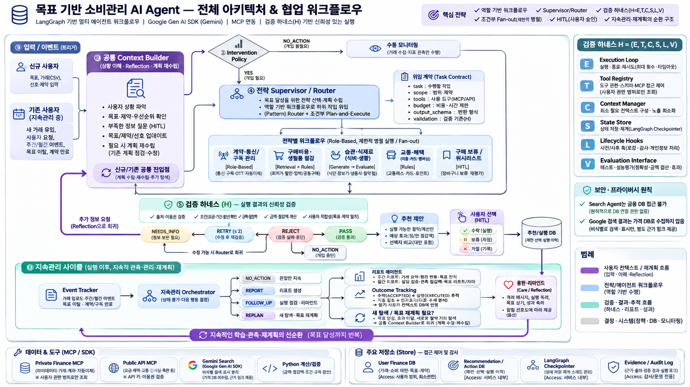
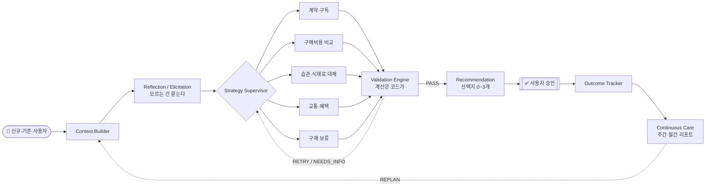

<div align="center">

# 🎯 Goal-Aware 소비관리 AI Agent

**목표를 세우고 → 소비를 이해하고 → 검증된 대안만 제안하고 → 실행을 함께 확인하는 순환형 소비관리 에이전트**


</div>

---

## ✨ 한눈에 보기

> 사용자의 금융정보를 보호한 채 **필요할 때만 개입**하고, 전문 전략에 **제한적으로 위임**하며, **검증된 대안만** 제안하고, 실행 결과와 바뀐 목표를 바탕으로 같은 계획·탐색 흐름에 **다시 진입**합니다.

<p align="center">
  
</p>

📐 전체 명세: [**통합 아키텍처 및 협업 워크플로**](docs/architecture/goal_aware_consumption_agent_architecture.md)

## 🧭 핵심 설계

**`Policy-Gated Supervisor + Role-Based Specialist Workflows + Verified Feedback + Event-Driven Continuous Care`**



| | 원칙 |
|---|---|
| 🧮 | **숫자는 코드가 만든다.** 금액·절감액·기간은 계산 결과만 LLM이 인용 |
| 🔍 | **검색은 보여주기만.** Gemini Google 검색 결과는 별도 창에 출처와 함께 표시, 저장·계산 입력 금지 |
| 🏛️ | **계산엔 확인된 가격만.** 사용자 확인값·영수증·공공 API |
| 🙋 | **결정은 사용자가.** 구매·해지·변경을 자동 실행하지 않음 |
| 💤 | **`NO_ACTION`도 정상.** 매 주기 억지로 절약안을 만들지 않음 |

### 5개 전문 전략

| 전략 | 실행 패턴 | 필수 검증 |
|---|---|---|
| 📱 계약 변경·구독 | Role-Based Workflow | 약정·위약금·결합할인·프로모션 후 총비용 |
| 🛒 구매비용 비교 | Retrieval + 결정적 랭킹 | 동일 상품·규격·배송비·단위당 가격 |
| ☕ 습관·식재료 대체 | Generate–Evaluate–Select | 실행 부담·선호·반동 소비 위험 |
| 🚌 교통·혜택 비교 | Rule-Based | 시행일·자격·이용량·중복 혜택 |
| ⏸️ 구매 보류·위시리스트 | HITL + 지연 확인 | 목표 영향·현금흐름·재확인 시점 |

## 🗺️ 로드맵

- [ ] **1. 데이터·권한 기반** — CSV/합성 거래, 정규화, Goal Monitor, 사용자별 스코프
- [ ] **2. 공통 제어** — Trigger, Context Builder, Intervention Policy, HITL, `NO_ACTION`
- [ ] **3. 핵심 전략 2~3개** — 공통 `TaskContract`·결과 스키마
- [ ] **4. 검증·승인** — 전략별 계산 검증, 출처 검사, 승인과 실행 분리
- [ ] **5. 지속 관리** — Event Tracker, Outcome Tracking, 주간·월간 리포트
- [ ] **6. 연결 고도화** — MCP, Gemini 검색 표시 경계
- [ ] **7. 실증** — 단순 Python 워크플로 대비 정확도·안전성·비용 비교

> ⚠️ 이 구조는 실험으로 입증된 최적값이 아니라 **기준 아키텍처 가설**입니다. 비교 실험 결과에 따라 단순화하거나 확장합니다.

---

## 🚀 시작하기

Python 3.12 이상, Git, [uv](https://docs.astral.sh/uv/)가 필요합니다. GitHub 저장소 초대를 받았다면 먼저 수락합니다.

```powershell
git clone https://github.com/Broogun/Multi_agent_project.git
cd Multi_agent_project
uv sync --group dev
uv run ruff check .
uv run pytest
```

외부 API를 사용하는 작업이 생기면 `.env.example`을 `.env`로 복사해 본인의 키를 입력합니다. `.env`는 Git에서 제외되며 키를 코드·문서·커밋에 넣지 않습니다.

## 👥 역할 분담

| 역할 | 담당 | 작업 위치 | 다음 작업 | 리뷰어 |
|---|---|---|---|---|
| A 검색·에이전트·전체 통합 | Broogun | `src/spending_agent/search/`, `agent/` | [에이전트 흐름](docs/todo/agent-graph.md), [검색 모듈](docs/todo/search-module.md) (실제 연동 보류) | parky2won |
| B 데이터·계산·평가 | parky2won | `src/spending_agent/data/`, `eval/`, `tests/` | [계산·가격 저장](docs/todo/calc-core.md), [평가 시나리오](docs/todo/eval-scenarios.md) | KIM-YUNHO |
| C 화면·연동·시연 | KIM-YUNHO | `app/` | [웹 UI](docs/todo/web-ui.md) | Broogun |

## 🤝 협업 방식

1. [작업 규칙](docs/05-working-agreement.md) → [현재 상태](docs/00-status.md) → 관련 문서와 [내 TODO](docs/todo/00-todo-list.md)를 읽습니다.
2. 최신 `main`에서 `<github아이디 소문자>/<YYMMDD>-<slug>` 브랜치를 만듭니다. 서로 다른 작업은 별도 브랜치로 진행합니다.
3. [contracts.py](src/spending_agent/contracts.py)의 입력·출력 형식을 지켜 구현합니다. 계약 변경은 혼자 결정하지 않고 팀원 모두와 합의합니다.
4. 다른 담당의 구현이 없으면 [fakes.py](src/spending_agent/fakes.py)를 사용합니다. 실제 구현이 생기면 같은 계약 테스트를 통과하도록 연결합니다.
5. 코드 변경에 필요한 테스트를 추가·수정하고, 린트와 테스트를 실행합니다.
6. `docs/00-status.md`의 자기 담당 줄과 TODO를 갱신합니다. 결정은 `docs/reports/`에 남기고, 스펙 변경은 `docs/02-specs.md`에 반영합니다.
7. 작업 브랜치를 push하고 PR을 엽니다. PR 템플릿의 테스트·AI 사용 항목을 채우고 담당 리뷰어를 지정합니다. 다른 팀원 승인과 CI 통과 후 Squash merge합니다.

일반적인 작업 시작 예시입니다. 브랜치 이름은 본인의 아이디·날짜·작업에 맞게 바꿉니다.

```powershell
git switch main
git pull --ff-only origin main
git switch -c parky2won/261124-calc-core
```

`main` 직접 push와 force push는 금지합니다. 공용 상태·TODO 문서는 자기 담당 줄만 수정해 충돌을 줄입니다.

## 🧪 다른 담당을 기다리지 않고 개발하기

| 개발 작업 | 먼저 사용할 가짜 구현 | 주고받는 형식 |
|---|---|---|
| C의 채팅·검색 창 UI | `fakes.fake_chat`, `fakes.fake_search_panel` | `ChatRequest`, `ChatResponse`, `SearchPanelEvent` |
| A의 에이전트 계산 호출 | `fakes.fake_calc_bulk_purchase`, `fakes.fake_forecast_goal`, `fakes.fake_record_user_price` | `ToolResult`, `UserPrice` |
| B의 실제 계산·저장 모듈 | 가짜 구현의 함수 형식과 계약 테스트 참고 | `ToolResult`, `UserPrice` |

가짜 구현은 화면과 연동을 위한 예시입니다. 실제 사용자의 계산 결과로 사용하지 않습니다. 새 실제 구현은 `tests/test_contracts.py`의 해당 `IMPLEMENTATIONS` 목록에 등록합니다.

## 🤖 AI 도구로 작업하기

Codex, Claude Code, Cursor는 [AGENTS.md](AGENTS.md)를 공용 진입점으로 사용합니다. 팀 규칙은 `docs/05-working-agreement.md`에 두고 개인 설정은 Git에서 제외된 `AGENTS.local.md` 또는 `CLAUDE.local.md`에 둡니다.

에이전트에게는 담당 TODO, 작업 브랜치, 완료 기준을 함께 알려줍니다. AI가 만든 변경도 올리는 사람이 읽고 테스트하며, 기본 규칙상 `main` push·PR merge·force push를 에이전트에게 맡기지 않습니다.

## ✅ 검증

```powershell
uv run ruff check .
uv run pytest
```

CI는 같은 린트를 실행하고 `uv run pytest -m "not live"`로 실제 API 테스트를 제외합니다. 실제 외부 API 테스트는 `@pytest.mark.live`로 표시하고 필요한 키를 설정한 환경에서만 별도로 실행합니다.

- 금액·절감액·기간은 계산 코드가 만들고 LLM은 그 결과만 인용합니다.
- 검색 결과는 별도 창에 표시하며 저장·수정·분석하거나 에이전트 입력에 넣지 않습니다. 링크된 페이지를 코드나 에이전트가 열지 않습니다.
- 계산에는 사용자가 확인한 가격과 공공 데이터만 사용합니다. 검색 결과 가격을 계산 입력으로 쓰지 않습니다.
- 구매·해지·변경은 사용자가 결정합니다.

검색 작업은 [검색 사용 원칙](docs/06-search-policy.md)을 먼저 확인합니다.

## 📁 문서와 폴더

| 위치 | 내용 |
|---|---|
| `src/spending_agent/` | 설정, 계약, 가짜 구현, A·B 모듈 |
| `app/` | C의 웹 UI |
| `tests/`, `eval/` | 계약·단위 테스트와 평가 시나리오 |
| `docs/architecture/` | 전체 아키텍처 명세와 그림 |
| `docs/todo/`, `docs/reports/` | 작업 목록과 결정·완료 기록 |
| `data/` | 로컬 데이터 보관 위치. 안내 문서만 Git에 포함 |

자세한 내용은 [폴더 구조](docs/01-folder-architecture.md), [스펙](docs/02-specs.md), [제품 계획](docs/03-product-plan.md), [용어집](docs/04-glossary.md), [온보딩](docs/07-onboarding.md)을 참고합니다.

## 🗄️ 이전 버전

공공데이터 수집·거래 분석·MCP Tool 코드는 태그 `archive/v0-data-pipeline`에 보존되어 있습니다. 필요한 코드는 작업 브랜치에서 검토한 뒤 가져옵니다.
