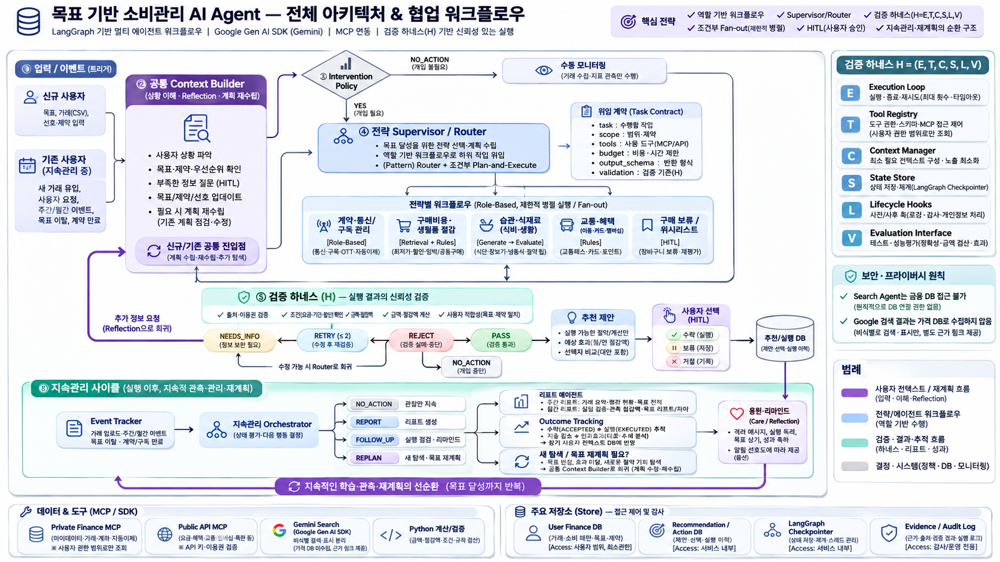
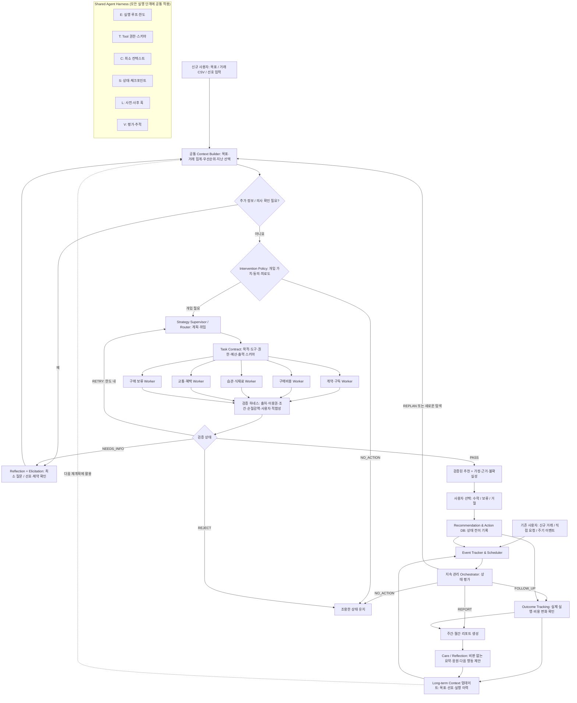
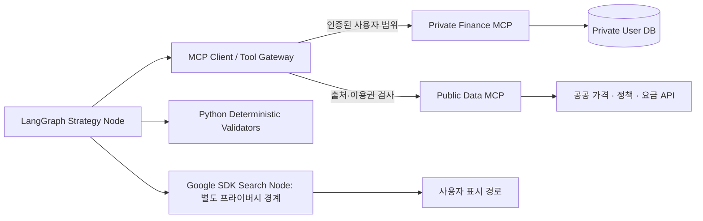
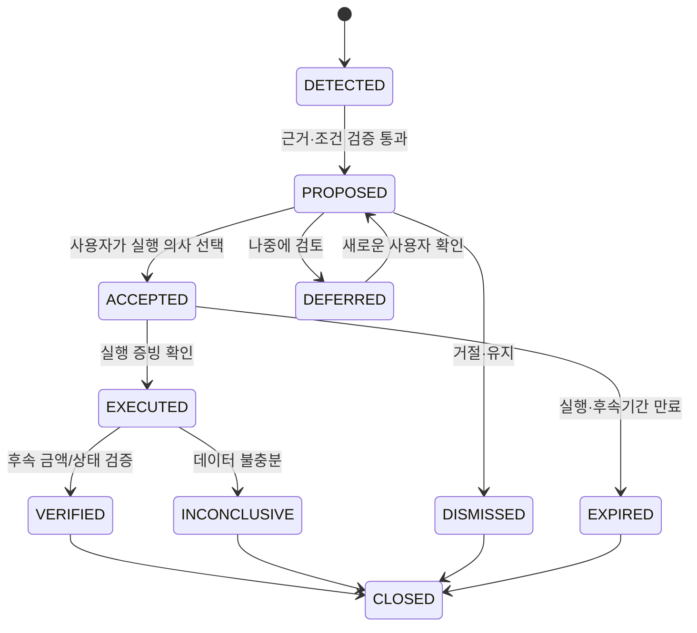

# Goal-Aware 소비관리 AI Agent — 통합 아키텍처 및 협업 워크플로 명세

> **문서 유형:** 시스템 아키텍처 / 에이전트 협업 설계 / Agent Harness / 데이터·보안 / 지속 관리 운영 명세  
> **버전:** v1.0 · 2026-11-25  
> **단계:** 구현 및 검증 전 설계안 (아키텍처 선택 가설)  
> **기술 가정:** LangGraph · Google Gen AI SDK (Gemini) · MCP · Python · PostgreSQL  
> **핵심 목적:** 목표 설정 → 소비 이해 → 필요한 대안 탐색·검증 → 사용자 선택 → 실행 여부 확인 → 주기적 관리·재계획

> **그림을 기반으로 한 설계 원칙:** '초기 유입 Agent'와 '지속 관리 Agent'를 단절된 시스템으로 취급하지 않는다. **신규 사용자와 기존 사용자는 동일한 Context Builder 및 전략 실행 경로에 재진입**한다. 지속 관리 중 추가 정보나 새로운 전략이 필요하면 공통 계획·탐색 단계로 돌아간다.

## 0. 아키텍처 그림



위 PNG는 구조를 한눈에 설명하는 **개념도**이다. 실제 동작의 조건 분기와 권한 관계는 아래 Mermaid 및 텍스트 명세를 기준으로 한다.

## 1. 핵심 아키텍처 결정

**선택한 기본 패턴:** `Policy-Gated Supervisor + Role-Based Specialist Workflows + Verified Feedback + Event-Driven Continuous Care`

| 설계 판단 | 채택 방식 | 선택 이유 |
|---|---|---|
| 전체 오케스트레이션 | **LangGraph StateGraph** | 조건부 분기, `interrupt`와 재개, 단계별 상태 기록 |
| 평상시 실행 | **Role-Based Workflow** | 거래 처리, 예산 계산, 검증처럼 순서가 안정적인 업무는 명시적 절차가 효율적 |
| 개입 판단 | **Policy Gate + Event Router** | 모든 주기에 절약안을 강제로 생성하지 않고 `NO_ACTION` 허용 |
| 복합 문제 조정 | **조건부 Supervisor / Plan-and-Execute** | 습관 대체 후 구매비용 비교 등 의존관계가 있는 하위 작업만 조정 |
| 전문화 | **전략별 Subgraph 또는 함수** | 계약·구매·습관·교통·구매 보류의 검증 조건이 다름 |
| 정보 부족 | **Elicitation + Human-in-the-Loop** | 추측하지 않고 필요한 최소 질문을 통해 진행 |
| 추가 검색 | **필요할 때 ReAct / Google Search** | 모델이 모르는 최신 일반 정보를 제한적으로 조사 |
| 독립적 조사 | **선택적 Fan-out / Fan-in** | 서로 의존하지 않는 허용된 API 조회만 병렬화 |
| 품질 개선 | **Evaluator–Optimizer / 제한적 Feedback** | 검증 실패 사유를 근거로 해당 후보만 수정·기각·재탐색 |
| 장기 운영 | **Event-Driven Monitoring + Outcome Tracking** | 주간·월간 일정 및 거래 이벤트에 반응하고 실행 결과를 후속 검증 |
| 제외 | **A2A, Swarm, Contract Net, 전면적 Debate, 정식 Blackboard** | 독립 원격 Agent나 다자 협상이 요구되지 않는 MVP에서 과도한 복잡성 방지 |

**중요:** 이 구성이 실험으로 입증된 전역 최적값은 아니다. 우선 채택할 **기준 아키텍처 가설**이며, 단일 Gemini + Python 대비 정확도·안전성·복구·비용을 비교해 유지·단순화해야 한다.

## 2. 통합 실행 흐름 (Mermaid)



**표현상 주의:** Mermaid의 `Shared Agent Harness`는 개별 단계 뒤에 단 한 번 호출되는 노드가 아니다. **모든 실행 경계에서 공통 규칙과 훅이 동작**하고, 전략별 검증기는 후보를 판정하는 별도 단계다.

## 3. 각 에이전트의 역할과 협업 계약

| 실행 주체 | Agent인가? | 패턴 | 입력 | 출력 / 다음 작업의 근거 |
|---|---|---|---|---|
| Data Ingestion / Goal Monitor | 주로 **결정적 서비스** | ETL + Rule Workflow | 승인된 거래·목표·기간 | 거래 집계, 반복지출, 목표 진척, 이상 이벤트 |
| Event Tracker | **결정적 서비스** | Event-Driven | 거래 업데이트, 예약 이벤트, 계약 만료, 사용자 요청 | `event_type`, `idempotency_key`, 점검 필요 여부 |
| Continuous-care Orchestrator | 조건부 **LLM 판단 + 규칙** | Supervisor + Policy Gate | 사용자 최신 상태, 개입·거절 이력 | `NO_ACTION / REPORT / FOLLOW_UP / REPLAN` |
| Context Builder | 주로 **결정적 서비스** | Context Engineering | 최소 집계·목표·선호·과거 선택 | 목적에 맞는 최소 컨텍스트 |
| Reflection / Elicitation Agent | **Gemini + HITL** | Elicitation | 불확실한 소비 의도·제약 | 사용자 확인값, 미해결 필드, 중단·재개 상태 |
| Strategy Supervisor / Router | 조건부 **Gemini** | Router + Selective Plan-and-Execute | 개입 대상·목표·검증 정책 | 1개 또는 복수의 구조화된 `TaskContract` |
| Specialist Workers | 일부 **Gemini + 도구**, 일부 규칙 | Role-Based Workflow / 제한적 ReAct | 위임 계약과 필요한 정보 | 후보 목록, 가정, 근거 참조, 검증 필요 조건 |
| Validation Engine | **결정적 계산 + 조건부 보조 LLM** | Evaluator / Feedback | 후보, 허용된 근거 데이터, 제약 | `PASS / NEEDS_INFO / RETRY / REJECT` |
| Recommendation Presenter | **Gemini 표현 계층** | Role-Based | 검증된 후보·계산 결과 | 과장 없는 설명, 선택지 0~3개 |
| Approval / Action Service | **인증된 백엔드** | HITL / State Machine | 사용자 UI 승인 | 수락·거절·보류 기록. 외부 결제나 계약 변경은 자동 실행하지 않음 |
| Report / Care Agent | **Gemini 표현 계층** | Report Generation | 검증된 사실, 주간·월간 통계, 사용자 선호 | 보고서, 공감형 피드백, 적절한 다음 행동 |
| Outcome Tracker | **결정적 서비스 + 선택적 질문** | Feedback & Event-Driven | 실행 확인, 신규 거래, 비용·증빙 | 관측 변화, 미확인 상태, 목표 재계산, 새 이벤트 |

### 3.1 Supervisor가 Worker에게 위임하는 내용

위임은 자유로운 대화가 아니라 **타입이 정해진 작업 계약**으로 한다.

```json
{
  "task_id": "tsk_001",
  "opportunity_id": "opp_coffee_001",
  "worker_type": "HABIT_REPLACEMENT",
  "objective": "커피 만족도를 유지하면서 월 지출을 낮추는 선택지 탐색",
  "context_refs": ["spending_summary_2026_11", "goal_travel_01"],
  "user_constraints": {
    "protected_spending": ["주말 카페 방문"],
    "max_extra_minutes_per_day": 10
  },
  "allowed_tools": ["get_spending_summary", "get_user_price_candidates"],
  "excluded_sources": ["unlicensed_product_price_results"],
  "time_budget_seconds": 20,
  "max_tool_calls": 5,
  "max_candidates": 3,
  "required_output_fields": ["strategy", "assumptions", "cost_estimate", "evidence_refs", "missing_fields"],
  "validation_profile": "HABIT_V1"
}
```

- **위임받은 Worker는 전체 금융 DB를 열람하지 않는다.** `context_refs`는 백엔드에서 사용자 범위를 검사한 뒤 필요한 집계로 해석한다.
- Worker는 검증 통과 여부나 최종 승인 상태를 스스로 결정하지 않는다.
- 중간 결과는 `TaskResult` 형식으로 Supervisor에 반환하며, 실패 유형과 누락 필드를 포함한다.
- **Fan-out은 독립적인 조회에서만 적용**한다. 예: 서로 다른 공공 데이터 API의 조회. '대체 행동 계획 → 필요한 제품 구매비용'처럼 의존하는 작업은 순차 처리한다.

## 4. 5개 전문 전략 워크플로

| 전략 | 권장 실행 패턴 | 정보/도구 | 필수 검증 |
|---|---|---|---|
| **계약 변경·구독** | Role-Based Workflow | 계약 조건, 청구 내역, 공식 요금제, `get_recurring_payments`, `get_mobile_plans` | 약정·위약금·결합할인·실제 사용량·프로모션 후 총비용 |
| **구매비용 비교** | Retrieval + Deterministic Ranking | 영수증, 사용자 입력 후보 가격, 공공가격 API, `get_public_price_baseline` | 동일 상품 여부, GTIN/규격, 배송비, 단위당 가격, 소진 속도 |
| **습관·식재료 대체** | Generate–Evaluate–Select | 소비 패턴, 만족도, 재고, 시간 제약, Gemini 대안 생성 | 실행 부담, 대체비용, 사용자 선호, 반동 소비 위험 |
| **교통·혜택 비교** | Rule-Based Comparison | 교통 사용량, 지역 자격, 교통패스·환급 규칙 | 시행일, 자격, 이용량 기준, 중복 혜택, 실제 비용 |
| **구매 보류·위시리스트** | HITL + Delayed Follow-up | 구매 희망가격, 필요성, 재무 목표·기한 | 목표 영향, 현재 현금흐름, 정해진 재확인 시점, 의사 강요 금지 |

**실행 최적화 원칙:** 5개 'Worker'가 항상 서로 다른 LLM 인스턴스인 것은 아니다. 계산과 적격성 판정이 명확한 Worker는 Python 함수 또는 LangGraph Subgraph로, 의미 해석·복합 계획에서만 Gemini를 호출한다.

## 5. 진입점, 개입 정책, 개입하지 않는 조건

### 5.1 사용자 진입점은 두 개지만 실행 파이프라인은 하나

- **신규 사용자:** 목표 금액·기간·현재 자금·선호 입력 → 선택적 거래 CSV/Mock 계좌 → Context Builder.
- **기존 사용자:** 직접 요청, 신규 거래, 주간·월간 일정, 추천 후속 확인, 목표 변경 → Event Tracker → 필요 시 **동일 Context Builder**로 재진입.
- **진행 중 재계획:** 데이터 부족·새로운 선택·실패 복구 → Reflection / Context Builder / Strategy Supervisor 중 필요한 위치로만 이동. 처음부터 온보딩을 반복하지 않는다.

### 5.2 Event Tracker가 발행할 이벤트

| 이벤트 | 트리거 | 기대 분기 |
|---|---|---|
| `TRANSACTION_IMPORTED` | 새 거래 기록 적재 완료 | 거래 정규화·소비 변화 재계산 |
| `WEEKLY_REVIEW_DUE` | 주간 정산일 | 요약이 유의미하면 REPORT, 아니면 NO_ACTION |
| `MONTHLY_REVIEW_DUE` | 월간 정산일 | 월간 지출·목표 달성률·변화 보고 |
| `GOAL_AT_RISK` | 목표 부족이 예상되는 경우 | 개입 정책 검토 후 REFLECTION 또는 REPLAN |
| `GOAL_COMPLETED` | 목표 달성 확인 | 성과 인정·사용자 선택에 따른 다음 목표 제안 |
| `RECURRING_PAYMENT_CHANGED` | 신규·가격변경·중단된 정기결제 | 이용 여부 확인 / 검토 |
| `CONTRACT_EXPIRING` | 사용자가 등록한 약정 종료 근접 | 계약 비교 여부 확인 |
| `FOLLOW_UP_DUE` | 사용자가 동의한 후속 점검 시점 | 실행 확인 및 결과 추적 |
| `USER_REQUESTED_REPLAN` | 직접 목표나 전략 변경 요청 | Context Builder 재진입 |

**리포트 생성 정책:** 매주 반드시 추천 3개를 내놓거나, 매월 반드시 절감액 증가를 보고하지 않는다. 확인된 데이터와 정보량이 충분할 때만 생성하며, 허위 추정치를 성과로 만들지 않는다.

### 5.3 `NO_ACTION`이 정상인 경우

- 목표가 계획대로 진행 중이고 특별한 조정 기회가 없다.
- 사용자가 유지하겠다고 명시한 지출이다.
- 동일한 추천을 최근 거절했거나 알림을 거부했다.
- 출처·계약·비용을 확인하지 못하여 유효한 대안을 만들 수 없다.
- 예상 절약액보다 시간·전환비용·불편이 과도하다.
- 데이터가 충분하지 않고 사용자에게 지금 질문할 가치도 낮다.

## 6. Agent Harness: H = (E, T, C, S, L, V)

> **Harness는 마지막 '검증' 노드만 의미하지 않는다.** E·T·C·S·L·V가 실행 전 과정에서 동일한 권한·상태·품질 정책을 적용하는 구조다. `Validation Engine`은 이 안에서 실행되는 업무별 검증기이다.

| 요소 | 역할 | 우리 서비스에서의 구현 | 실패 예방 |
|---|---|---|---|
| **E — Execution Loop** | 실행 순서, 종료, 예외 처리 | LangGraph 조건부 Edge·재시도 예산·타임아웃·NO_ACTION | 무한 탐색, 조용히 무시되는 실패 |
| **T — Tool Registry** | 도구 명세, 접근권한, 호출 제어 | MCP Gateway/Tool allowlist·Schema·read/write 분리 | 불필요한 DB 접근, 도구 오용 |
| **C — Context Manager** | 현재 목적에 맞는 최소 정보 조립 | 거래 원문 대신 집계·계약 필수조건·프롬프트 버전 | 민감정보 과전달, 과거 맥락 오염 |
| **S — State Store** | 실행 상태·장기 기억·재개 | LangGraph Checkpointer + 앱 DB 분리 | 승인/검증 대기 중 상태 손실 |
| **L — Lifecycle Hooks** | 호출 전후 정책 적용·감사 | `pre_tool`, `post_tool`, `pre_write`, `pre_response` | 권한·계산·이용권 위반 후늦은 발견 |
| **V — Evaluation Interface** | 추적과 평가 | 정답셋·tracing·회귀 테스트·실패 유형 집계 | 작동 여부/정확도 미확인 |

### 6.1 전략별 Validation Guard

- **공통:** 인증/권한, 출처, 데이터 이용권, 최신성, 신뢰도, 사용자 유지 의사, 과장된 표현 차단.
- **계약·구독:** 위약금, 결합할인 손실, 계약기간, 가입 가능성, 서비스 조건, 가격 변동.
- **구매비용:** 상품 동일성, 단위 환산, 수량, 배송비, 소비기한, 회원 전용가격.
- **습관·식재료:** 사용자 선호, 실제 시간 부담, 대체 지출, 건강·생활상 제약.
- **교통·혜택:** 지역·기간·대상자 자격, 실제 교통 이용, 중복 혜택.
- **구매 보류:** 목표 유지 가능성, 현금흐름, 미래 확정 비용, 임의적인 소비 통제 금지.

### 6.2 검증 실패 시 정확한 복구 경로

| 검증 상태 | 의미 | 다음 행동 |
|---|---|---|
| `PASS` | 필요한 조건과 근거를 충족 | 추천 표시 + 사용자 선택 |
| `NEEDS_INFO` | 사용자에게만 알 수 있는 조건이 빠짐 | **Reflection / Elicitation으로 복귀**, 승인 대기 |
| `STALE_DATA` | 출처 기준일 또는 약정 정보가 오래됨 | 허가된 소스 재조회; 실패 시 보류 |
| `RETRYABLE_ERROR` | 도구 타임아웃·일시 장애 | 제한된 횟수만 재시도, 이후 부분 결과·보류 |
| `CONSTRAINT_FAIL` | 조건·상품 적합성 불충족 | 해당 후보만 기각, 다른 후보 판단 |
| `CALCULATION_ERROR` | 금액 계산·단위 환산 불일치 | 결정적 함수 재계산; 불일치 지속 시 차단 |
| `SOURCE_NOT_PERMITTED` | 데이터 원천의 이용권 부적합 | 해당 원천 **즉시 제외** (재시도로 우회하지 않음) |
| `NO_VALID_ALTERNATIVE` | 유효한 대안 없음 | `NO_ACTION`, 사용자에게 필요시 이유 안내 |
| `BUDGET_EXCEEDED` | 호출·지연·재탐색 예산 소진 | 중단·보류, 운영 로그 기록 |

**권장 초기 한도(실험용):** 동일 실패 원인별 재시도 최대 2회, 추천 후보 최대 3개, 사용자 질문은 꼭 필요한 질문만 묶어서 전달. 실제 한도는 실험 결과에 따라 결정한다.

### 6.3 하네스의 '주기적 검증'을 정확히 구분

- **실시간 운영 하네스:** 매 API 호출·도구 실행·상태 변경 시 가드와 훅이 동작. 개인별 정기 점검에서도 동일하게 적용.
- **오프라인 평가 하네스:** 스케줄러/CI가 별도의 합성 테스트 데이터로 권한 누출, 중복 이벤트, 계산 오류, 재개 성공률 등을 주기적으로 재검증.
- **절대 금지:** 모델 자신이 '하네스가 안전하다'고 말했으므로 실제 보안 점검을 통과했다고 간주하는 것.

## 7. Google SDK · MCP · Python의 역할과 신뢰 경계

### 7.1 Google Gen AI SDK

| 활용 | 허용할 입력 | 산출물 및 취급 |
|---|---|---|
| 일반 Gemini 추론 | 목적에 맞는 최소화된 소비 집계·선호 | 성찰 질문·대안 초안·설명. 계산·권한 판정의 최종 권한 없음 |
| Google Search Grounding | 개인정보를 제거한 일반 검색 질의 | 사용자가 요청한 최신 정보 안내·표시. 원문 및 검색 결과의 활용은 최신 약관 준수 |

**검색 경계 원칙:** Search Node는 Private Finance DB에 직접 접근하지 않는다. Google 검색 결과를 상품·가격 데이터베이스로 자동 축적하거나 자체 계산 입력으로 재활용하는 구조를 기본 기능으로 설계하지 않는다. 검색 정보의 노출·표시·저장·로그에 관한 계약상 허용 범위는 **실제 배포 전 최신 약관 확인**이 필요하다.

### 7.2 MCP는 데이터·도구 인터페이스에 배치



**권장 Tool 예시**

- `get_spending_summary`: 사용자의 승인 범위 내 지출 집계 조회.
- `get_recurring_payments`: 반복 결제 후보 반환.
- `get_goal_status`: 목표액·기한·진척 조회.
- `get_public_price_baseline`: 공공 조사 가격·조사일·출처 반환.
- `get_mobile_plan_candidates`: 계약 이용권이 확보된 요금제 카탈로그 조회.
- `get_policy_rules`: 교통·혜택 규칙과 적용 기간 조회.
- `get_outcome_history`: 사용자의 이전 선택과 증빙 상태 확인.

`calculate_savings`, `validate_unit_price`, `forecast_goal`, `classify_transaction`, `assert_user_scope`는 **MCP가 아닌 일반 Python 서비스**로 먼저 구현하는 편이 단순하다. `record_action`, `delete_transactions`, `change_goal` 같은 **쓰기 작업**은 사용자의 인증·승인을 검사하는 Action Service에 둔다.

> MCP가 권한을 자동으로 보장하는 것은 아니다. Tool 목록 및 직접 ID 조회, 공유 캐시, 오류 로그에도 동일한 서버 측 사용자 스코프·권한 검사가 필요하다.

## 8. 데이터 저장소와 개인정보 처리

| 저장소 | 데이터 | 접근 정책 |
|---|---|---|
| **User Finance DB** | 거래, 계약, 재무 목표, 선호, 정규화 데이터 | 사용자별 Row-Level Security 등, 백엔드 서버만 인증된 스코프에서 조회 |
| **Recommendation / Action DB** | 기회, 제안, 사용자 선택, 실행 확인, 후속 결과 | 승인된 서비스 로직만 쓰기, `recommendation_id`로 결합 |
| **LangGraph Checkpointer** | 실행 위치, 남은 검증, 재개·승인 대기, 작업 참조 | 최소 상태만 저장. 민감 거래 원문과 검색 결과를 불필요하게 복제하지 않음 |
| **Evidence / Audit Store** | 검산, 출처 메타데이터, 조건 판정, 접근 감사 | 역할별 제한 접근, 보존·삭제·백업 정책 및 추적 데이터 최소화 |

### 8.1 최소 데이터 모델 (개념)

```text
users(id, consent_version, notification_prefs, created_at)
goals(id, user_id, amount, deadline, baseline_funds, preferences, status)
transactions(id, user_id, occurred_at, amount, direction, merchant, category, source, batch_id)
contracts(id, user_id, contract_type, terms_ref, expiry_at, consent_scope)
opportunities(id, user_id, trigger_type, expense_ref, status, policy_reason)
recommendations(id, user_id, opportunity_id, strategy, validated_at, expires_at, evidence_ref)
actions(id, user_id, recommendation_id, decision, executed_at, verified_at)
outcomes(id, user_id, action_id, observed_delta, confidence_level, confounders)
user_preferences(user_id, protected_categories, intervention_cooldown, feedback_style)
evidence(id, source_type, checked_at, permission_class, calculation_trace_ref)
workflow_runs(id, user_id, thread_id, run_type, status, last_checkpoint_ref)
```

**개인정보 처리 규칙:** 수집 최소화, 목적·동의 범위 명시, 전송·저장 암호화, 권한 적용을 조회 전에 수행, 운영자 접근 최소화, 추적 로그의 PII 제거, 원본·체크포인트·캐시·백업 파기를 포함하는 보존기간·삭제 절차 마련.

### 8.2 권한 행렬 (요약)

| 주체 | Private Finance 조회 | Search 실행 | Action 쓰기 | 운영 로그 |
|---|---|---|---|---|
| 본인 사용자 | 본인 데이터만 | UI 요청 | 본인 승인 | 본인 활동 범위 |
| Context Builder | 목적별 집계만 | 불필요 | 불가 | 최소 메타데이터 |
| Strategy Worker | 위임된 최소 집계 | 허용된 Node를 통해서만 | 직접 불가 | 작업 ID 중심 |
| Search Node | **접근 불가** | 비식별 질의 | **불가** | 검색 원문 보존 최소화 |
| Action Service | 승인 검증에 필요한 정보 | 불필요 | 서버 인증·멱등성 검사 후 가능 | 감사 이벤트 |
| 운영자 | 원칙적으로 직접 열람 불가 | 해당 없음 | 직접 대리 실행 금지 | 최소 운영 지표 |

## 9. 지속 관리 Agent: 주간·월간 리포트, 행동 확인, 응원, 재계획

### 9.1 지속 관리의 네 가지 결정

```text
Event Tracker
  └─ Continuous-care Orchestrator
        ├─ NO_ACTION   : 조용히 유지 / 다음 점검 예약
        ├─ REPORT      : 주간·월간 리포트, 동의된 범위의 피드백
        ├─ FOLLOW_UP   : 이전 전략 실행·청구 중단·거래 변화 확인
        └─ REPLAN      : Context Builder → Reflection → 전략 Supervisor로 재진입
```

### 9.2 주간 보고서에 담을 것

- **확인된 사실:** 주간 총지출, 주요 카테고리 변화, 예정된 고정비, 다음 주 지출 주의점.
- **목표:** 최근 추세와 목표 일정의 관계; 부족 금액·여유금의 **가정 표시**.
- **성찰:** 사용자가 허용하는 경우만 '유지할 소비 / 조정해 볼 소비' 확인.
- **제안:** 꼭 필요할 때만 1~2개. 같은 제안을 반복하거나 사용자가 보호한 지출을 강요하지 않음.
- **공감형 메시지:** 긍정적 행동은 인정하되 과장된 칭찬·죄책감 유도·비난 금지.

### 9.3 월간 보고서에 담을 것

- 한 달의 고정비·일상적 변동비·비정기 지출과 계획 대비 차이.
- 달성된 행동 / 수락 후 미실행 / 확인되지 않은 추천을 **별도로** 표시.
- 사용자 목표의 진척·새로운 소득/지출 제약 반영.
- 필요 시 **전략 재계획** 제안: 목표 완료, 계약 변화, 반복지출 증가, 사용자 선호 변화.
- 성과 측정: `관측 지출 감소`와 `Agent 개입의 인과적 효과`를 구분. 후자는 별도의 실험 없이는 확정하지 않음.

### 9.4 Outcome 생명주기



**사후관리에서 하네스가 수행하는 일:** 거래 중복 검사, 새로운 가격·조건 만료 검사, 사용자 동의·알림 정책, 보고서의 사실성, 동일 절감액의 중복 집계, 예약된 작업의 중복 실행 방지.

## 10. 실제 실행 예시: 커피 지출 절감 후 재계획

1. **신규 입력:** 사용자가 목표를 정하고 거래 CSV를 업로드한다.
2. **정규화:** 커피 구매 패턴을 집계한다. 결제내역만으로 구매한 음료의 정확한 품목은 알 수 없음을 명시한다.
3. **개입 판단:** 목표 부족 여부, 커피 지출 증가, 사용자의 조정 의사, 최근 거절 이력을 확인한다.
4. **Reflection:** '커피 자체는 유지하고 싶다'는 사용자 선호를 확인한다.
5. **Supervisor 위임:** `HABIT_REPLACEMENT`에 소비 횟수 조정안을 요청한다. '집에서 마시는 대안'에 비용 데이터가 필요하면 `PURCHASE_COMPARISON`을 **순차 위임**한다.
6. **도구 실행:** 사용자 제공 상품가격·공공가격처럼 사용 가능한 자료만 이용해 비용을 계산한다. Google 검색은 절약 아이디어 안내에만 필요한 경우 호출한다.
7. **검증:** 출처·단위·전체 구매비용·사용자 시간 제약·목표 영향을 검사한다.
8. **HITL:** 사용자가 '주 1회만 대체'를 선택한다. `ACCEPTED`를 기록하며 실행을 완료했다고 가정하지 않는다.
9. **2주 후:** `FOLLOW_UP_DUE` 이벤트 → 후속 거래와 실행 여부를 확인 → `EXECUTED` 또는 `INCONCLUSIVE`.
10. **지속 관리:** 주간 보고서에서 확인된 변화만 안내. 사용자가 '생각보다 번거롭다'고 답하면 **Context Builder에 재진입**하여 새로운 대안을 설계한다.

## 11. 실험과 평가 계획

### 11.1 아키텍처 비교 (동일 데이터·모델·예산 가능한 범위에서 통제)

| 실험군 | 구성 | 검증하려는 기여 |
|---|---|---|
| A0 | Gemini SDK 단독 | 단일 모델 기준선 |
| A1 | SDK + Python 계산·규칙·검증 | 결정적 처리의 추가 가치 |
| A2 | A1 + LangGraph 분기·상태·HITL | 실행·재개·상태 관리 효용 |
| A3 | A2 + 원인별 Feedback | 재탐색이 실제 오류 개선에 기여하는지 |
| A4 | A3 + 조건부 Supervisor·복합 전략 | 복합 요청의 효용 대비 비용 |
| A5 | A4 + Adaptive Budget | 난이도별 모델·도구 예산 조절의 이점 |

### 11.2 핵심 평가 지표

| 평가 축 | 지표 |
|---|---|
| 개입 품질 | Intervention Precision@K, 불필요한 알림률, 사용자의 유지 선호 위반률 |
| 전략 품질 | 검증된 추천 비율, 유효 후보 Coverage@K, 계산 오류·허위 절감 주장률 |
| 도구 효율 | Tool Call 수, 실패 후 복구율, 호출 비용, p50/p95 지연 |
| 안전·권한 | PII 외부 전송·교차 사용자 접근·무단 저장·쓰기 우회 **0건을 목표** |
| HITL | 필요한 질문 수, 승인 전후 상태 전이의 정확성, 재개 성공률 |
| 장기 관리 | 보고서 적시성, 실행 확인율, 관측 변화 계산 정확성, 중복 알림률 |
| 운영 하네스 | 회귀 테스트 통과율, 중복 이벤트 처리, 기한 만료 조건 재검사 |

### 11.3 실패 케이스 (최소 포함)

- 다른 사용자의 거래 ID로 직접 조회 시도 → **DENY**.
- 같은 이벤트가 두 번 수신 → 정확히 한 번만 상태 변경.
- 단위가 다른 상품을 동일 상품으로 오판 → 비교 기각/사용자 확인.
- 약정 위약금 누락 → 순절감액 확정 금지.
- 사용자가 유지하겠다고 한 소비 → 불필요한 개입 차단.
- Google Grounding 결과에서 나온 가격을 자체 DB에 저장하려는 작업 → 출처 정책 위반 차단.
- 검색·공공 API 장애 → 제한된 재시도·부분 결과·보류.
- 승인한 추천이 실제 실행됐는지 확인되지 않음 → `ACCEPTED` 유지 또는 `INCONCLUSIVE`.
- 계획 변경 후 예전 체크포인트 재개 → 현재 동의·가격·목표 제약 재검사.
- 변화가 없는 주간 점검 → 추천을 억지로 생성하지 않고 `NO_ACTION`.

## 12. 구현 우선순위 (MVP → 확장)

1. **데이터·권한 기반:** CSV/합성 데이터 Adapter, 정규화, Goal Monitor, 사용자별 DB 스코프, 삭제 정책.
2. **공통 제어:** Trigger Engine, Context Builder, Intervention Policy, Reflection/HITL, `NO_ACTION`.
3. **핵심 전문 전략:** 구독·계약 / 구매비용 / 습관 대체 중 우선 2~3개. 모두 공통 TaskContract와 결과 스키마 사용.
4. **검증·승인:** 전략별 계산 검증, 출처·이용권 검사, 승인과 실행 분리, 결과 상태 저장.
5. **지속 관리:** Event Tracker, Outcome Tracking, 주간·월간 리포트, 필요 시 같은 Context Builder로 재계획.
6. **연결 고도화:** Private/Public MCP, 필요 시 Google Search Grounding의 별도 표시 경계.
7. **실증:** 단순 Python 워크플로 대비 성능과 운영 복잡성 비교; 성과가 확인될 때만 Supervisor·Fan-out·ReAct 확장.

## 13. 미확정 사항과 검증 가정

| 항목 | 현재 상태 |
|---|---|
| 정식 은행/카드 연동 | **미구현.** MVP는 사용자 제공 CSV·합성 거래·공식 테스트 환경으로 검증 |
| 사용자 행동 변화 | **미검증 가설.** 주간 성찰과 공감 메시지가 절약을 유발한다는 인과효과는 실험 필요 |
| 외부 상품·가격 데이터 | **원천별 별도 허가 필요.** Google Grounding을 가격 수집 API로 사용하지 않음 |
| 개입 점수식·주간 빈도 | 초기 정책 가설. 사용자 반응·불편과 평가셋에 따라 조정 |
| 절감액 계산 | 가정·계약기간·전환비용·반동지출을 정확히 구분해야 함 |
| '최적' 아키텍처 | 아직 확정 아님. A0~A5 비교 결과에 따라 단순화 또는 확장 |

## 14. 참고자료와 설계 출처

다음은 사용자가 제공한 교육자료의 개념을 업무 아키텍처로 적용한 것이다. 자료가 우리 소비관리 서비스의 효과를 직접 실험한 것은 아니다.

- `1_MA_Basic_개념과구현(1).pdf` — LangGraph State/Node/Edge, Router, ReAct, HITL, Checkpointer.
- `2_MA_Basic_Plus_핵심협업패턴(1).pdf` — Role-Based Workflow, Supervisor, Handoff, Fan-out/Fan-in, Feedback, Debate 및 패턴 선택.
- `3_MA_Advanced_동적확장패턴(1).pdf` — Dynamic Planning, Blackboard, Adaptive Orchestration, 복합 위임과 시스템 평가.
- `3_MA_Advanced_Agent_Harness(1).pdf` — **H = (E, T, C, S, L, V)**; 실행 루프, 도구, 컨텍스트, 상태, 훅, 평가.
- `1_MCP_Basic_구조와_구현(1).pdf` — MCP Client/Server, Tool 경계와 재사용성.
- `2_MCP_Plus(1).pdf` — 공유 MCP의 인증·인가·캐시·오류 복구·Elicitation·도구 네임스페이스.
- `SI_Part1_스케일링과검증(1).pdf` — 생성/검증 분리, Coverage@K, 검증 비용과 구조 실험.
- `2_SI_Part2_피드백과탐색(1).pdf` — 실행 피드백, 필요할 때 검색, 재탐색, 평가·도입 판단.
- `1_A2A_Basic(1).pdf` — 원격 독립 Agent 협업 프로토콜. **이번 구조에서는 A2A를 사용하지 않음.**

---

### 핵심 한 문장

**사용자의 금융정보를 보호한 채 필요할 때만 개입하고, 전문 전략에 제한적으로 위임하며, 검증된 대안만 사용자에게 제안하고, 실행 결과와 변화한 목표를 바탕으로 같은 계획·탐색 워크플로에 다시 진입하는 순환형 소비관리 Agent.**
