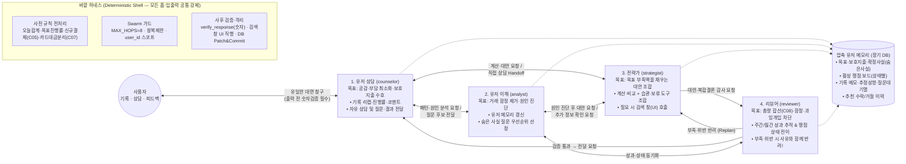

# 압축 메모리 기반 Swarm 멀티에이전트 설계 및 실행 계획

> **작성일:** 2026-11-27  
> **상태:** 설계안 및 실행 계획 초안 (팀 합의 전)  
> **관련 문서:** [기존 통합 아키텍처 명세](./goal_aware_consumption_agent_architecture.md) · [P1 단일 에이전트 기준선 리포트](../reports/261126-2030-a-single-agent-p1-baseline.md) · [08 데모 데이터](../08-demo-data.md) · [09 시연 시나리오](../09-demo-scenario.md) · [10 LLM 평가 계획](../10-llm-eval-plan.md) · [작업 규칙](../05-working-agreement.md) · [검색 원칙](../06-search-policy.md)

---

## 1. 배경: 왜 '압축 메모리 기반 Swarm'으로 수렴했는가

### 1.1 문제 출발점 2가지
1. **설계 피드백:** 기존 통합 아키텍처 및 고정 파이프라인은 *"너무 확정적인 워크플로우(순서도) 같다. 멀티에이전트 느낌이 덜하다"*는 피드백을 받았다.
2. **P1 단일 에이전트 기준선 실측 결과 ([리포트](../reports/261126-2030-a-single-agent-p1-baseline.md)):**
   - 결과: **통과 2 · 부분 2 · 실패 5**, 1회 실행 입력 **356,495 토큰**(호출당 최대 32,751), 소요 **134초**.
   - 확인된 약점 4가지:
     1. **복합 결론 실패 (C08):** 구독 해지(26,300원)만으로 적금 부족분(40,000원)을 못 채운다는 결론과 주말 배달 조정을 묶지 못함.
     2. **새 결제 미감지 (C05):** 웹툰패스 첫 결제를 새 구독으로 짚지 못함.
     3. **질문 우선순위 낭비:** 주 3개 한도 중 2개를 정형 이체(월세·적금)에 소모.
     4. **입력 토큰 폭증:** 매 호출마다 전체 대화와 거래 내역을 재전송해 입력이 출력의 약 100배까지 증가.

### 1.2 후보 패턴 비교 및 선택 이유

| 패턴 | 장점 | 우리 프로젝트에서의 한계 | 판정 |
|---|---|---|---|
| **고정 파이프라인 / 분기 워크플로우** | 예측 가능, 구현 단순 | 코드(`if/else`)가 경로를 고정해 멀티에이전트 자율성이 없음 | **기각** |
| **블랙보드 제어 루프 (팀장 매 턴 왕복)** | 공유 상태로 중앙 통제 가능 | 작업자 1명 부를 때마다 팀장 LLM을 다시 거쳐 호출 ~2배 증가, 단순 기록·평가 반복에 비효율적 | **제어 루프 기각** *(압축 메모리 아이디어만 채택)* |
| **순수 Swarm (원문 대화 Handoff)** | 팀장 없이 자율 협업, 대화 자연스러움 | 대화 전체를 넘겨 P1의 35만 토큰 폭증 재발 + 복합 결론(C08) 검증 주체 부재 + 무한 핑퐁 위험 | **보완 필요** |
| **압축 메모리 기반 Swarm (채택안)** | **팀장·고정 경로 없는 진짜 자율 협업(Handoff·반려)** + **압축 메모리로 토큰 차단** + **리뷰어·하네스로 C08/안전 보장** | 홉 제한·상태 압축·반려 기준 설계 필요 | **채택** |

---

## 2. 확정된 서비스 흐름 (최신 기준)

| 시점 | 들어오는 입력 | 서비스가 하는 일 | 유저에게 말하는 내용 | 전략 개입 |
|---|---|---|---|---|
| **① 온보딩 (D0, 1회)** | 고정 질의(목표·수입·거주·보호 지출) + 3개월 통합 거래 CSV | 거래 함정 필터링, 숨은 사실 확인용 추가 질의(최대 3개), 진짜 원인 진단, 초기 선택지 도출 | 진단 요약 + 질문 또는 선택지 0~3개 | **함** |
| **② 매일 거래 동기화** | 하루치 통합 거래 CSV | DB 적재만 수행 (밤 10시 이후 결제는 다음 날 반영) | 말 안 함 | 안 함 |
| **③ 유저 이벤트 (수시)** | 거래 기록 작성(거래 전 선기록·현금 포함), 질문 답, 수락·보류·거절 | 소비 패턴·추정 사실·다음 질문 후보를 **유저 메모리에 갱신** + 오늘 요약·목표 진행률 계산 | **목표 진행률 + 오늘 소비 간단 RECAP + 짧은 코멘트/공감** | **안 함** *(단, 기록 안에 직접 질문·고민을 적으면 자율 판단으로 연결 가능)* |
| **④ 정기 피드백 (주간·월간)** | 일요일 저녁(주간) · 말일 저녁(월간) 도래 | 쟁점 상태 전이(신규·유지·개선·악화·해결, 무관 변화 분리) + 목표 달성도 + 복합 선택지 0~3개 + 질문(주 3개 한도) | 정리된 주간/월간 피드백 + 선택지 + 수락·보류·거절 버튼 | **함** |
| **⑤ 자유 상담 (`chat`)** | 유저가 직접 건 고민·질문·가격 확인 입력 | 공감·상담 진행, 계산·대안 필요 시 전략가로 바통 터치(+ 검색 창 HITL) | 자연스러운 대화 응답 (+ 필요 시 검색 창·계산 결과) | **요청 시만** |

> **문서 정렬 필요 사항:** 현재 [08-demo-data.md](../08-demo-data.md), [09-demo-scenario.md](../09-demo-scenario.md), [10-llm-eval-plan.md](../10-llm-eval-plan.md)에는 ③ 유저 이벤트 시 *"말하지 않는다"*로 적혀 있다. 팀 합의를 통해 **"기록 시 절약 잔소리·전략 강요는 하지 않되, 목표 진행률 + 오늘 소비 RECAP + 짧은 코멘트는 응답한다"** 로 기준을 통일해야 한다.

### 전 구간 절대 원칙 ([작업 규칙](../05-working-agreement.md), [검색 원칙](../06-search-policy.md))
- **숫자는 계산 코드만 생성:** LLM 암산 금지. 최종 출력 전 하네스 `verify_response` 필수 통과.
- **검색 결과 완전 격리:** 검색 창(UI)으로만 직행하며, 에이전트 입력·Swarm 상태·유저 메모리에 본문을 넣지 않는다(`panel_id`만 기록). 계산에는 사용자가 확인해 입력한 가격(`UserPrice`)과 공공 데이터만 사용한다.
- **사용자 결정권과 비개입:** 구매·해지·변경 자동 실행 금지, 보호 지출 침해 금지, 개입 가치 없으면 `NO_ACTION`.

---

## 3. 압축 메모리 기반 Swarm 아키텍처

### 3.1 핵심 철학
- **고정 화살표·중앙 팀장 제거:** 코드로 *"기록이면 A→B, 주간이면 C→D→E"*를 고정하지 않는다.
- **관점이 다른 4명의 자율 에이전트:** 각 에이전트가 뚜렷한 목표와 `handoff_to_<agent>()` 도구를 갖고, 현재 상황과 압축 메모리를 보고 **누구에게 넘길지, 반려할지, 끝낼지** 스스로 결정한다.
- **견제와 균형:** `전략가`(목표 금액 채우기) ↔ `리뷰어`(총량 합산·함정·과잉개입 감사 및 반려) ↔ `유저 상담`(유저 부담·감정·보호 지출 수호)의 상호작용으로 단순 파이프라인이 못 내는 품질과 에이전트성을 만든다.

### 3.2 전체 네트워크 구조도



### 3.3 4개 자율 에이전트 상세 역할과 경계

| 에이전트 | 핵심 목표(관점) | 주요 도구(Tools) | Handoff 대상 | 엄격히 금지하는 것 |
|---|---|---|---|---|
| **1. 유저 상담 (`counselor`)** | 유저의 감정·지속 가능성·보호 지출을 지키며 이해하기 쉽게 소통 | `handoff_to_analyst`, `handoff_to_strategist`, `handoff_to_reviewer`, `respond_to_user` | 분석 필요 시 `analyst`, 대안·계산 요청 시 `strategist`, 검증 확인 필요 시 `reviewer` | **자체 암산, 자체 절약 전략 생성**, 보호 지출 건드리기, 비난·강요 |
| **2. 유저 이해 (`analyst`)** | 거래·기록 속 함정을 걷어내고 진짜 원인(수입 감소 vs 지출 과다 등)과 꼭 물을 질문만 선별 | `propose_profile_delta`, `update_issue`, `queue_question`, `handoff_to_counselor`, `handoff_to_strategist`, `handoff_to_reviewer` | 질문 필요 시 `counselor`, 대안 필요 시 `strategist`, 정기 상태 정리 시 `reviewer` | 정형 이체(월세·적금) 질문 낭비, 추정치를 `hard_fact`로 단정, 장기 DB 직접 덮어쓰기 |
| **3. 전략가 (`strategist`)** | 목표 부족액을 실제로 채울 수 있는 현실적 대안 조합(구독·계약·구매비교·습관·보류) 도출 | 계산·비교 Tool(`forecast_goal`, `calc_net_saving`, `calc_bulk_purchase`, `get_mobile_plan_candidates`, `get_policy_rules`, `get_price_baseline`), 습관 Tool(`get_strategy_library`, `get_spending_pattern`), `open_search_panel`, `propose_action`, `handoff_to_reviewer`, `handoff_to_analyst`, `handoff_to_counselor` | 대안 완성 시 **반드시 `reviewer`로 검증 요청**, 정보 부족 시 `analyst` 또는 `counselor` | 검색 결과 가격을 계산 입력으로 사용, `reviewer` 검증 없이 최종 제안 확정 |
| **4. 리뷰어 (`reviewer`)** | **C08 총량 합산 검증**, 함정·보호지출·거절이력 차단, 성과 추적(`Outcome Tracking`)에서 외부 요인(방학·약정종료) 분리 | `check_gap_coverage`(코드 검산), `update_issue_status`, `record_review_verdict`, `handoff_to_strategist`(반려), `handoff_to_counselor`(통과), `handoff_to_analyst` | **부족·위반 시 사유와 함께 `strategist`로 반려**, 통과 시 `counselor`로 전달 | 대안 자체를 새로 지어내기, 서비스 무관 변화를 절약 성과로 집계 |

> **전략가를 1개로 통합한 이유:** 기존 `tools.py`에서 `strategy_calc`와 `strategy_habit`을 나눴더니 호출 누락과 `propose_action` 권한 분산 문제가 생겼다. 1차 구현에서는 **`strategist` 1명이 정량·습관 도구를 함께 조합**하도록 단순화하고, 향후 P2/P3 평가에서 도구 혼선이 실제로 관측될 때만 내부 서브에이전트(`calc ↔ habit`)로 분리한다.

### 3.4 진입점(`entry_agent`) 및 HITL 재개(`active_agent`) 규칙
고정 파이프라인 없이도 상황에 맞게 자연스럽게 시작할 수 있도록 **최초 활성화 규칙만** 단순하게 둔다.
- **유저 입력 (`user_record`, `chat`, 질문 답변, 확인 가격 입력):**
  - 직전 턴에 질문이나 검색 가격 입력을 기다리던 **`active_agent`** 가 있으면(LangGraph Checkpointer) **그 에이전트로 즉시 복귀(Resume)**.
  - 새 대화·기록이면 **`counselor`** 가 진입해 맥락을 보고 직접 끝낼지(`respond_to_user`) 다른 에이전트로 넘길지 판단.
- **정기/초기 배치 (`onboarding`, `weekly_review`, `monthly_review`):**
  - **`analyst`** 가 진입해 사전 규칙 분석과 누적 메모를 통합한 뒤 `strategist` / `reviewer` / `counselor`로 자율 전개.

---

## 4. Swarm의 약점을 잡는 3대 핵심 장치

### 4.1 장치 ①: 압축 유저 메모리 + 슬림 Handoff 패킷 (토큰 폭증 차단)
Swarm의 최대 약점은 대화 원문(`messages`)을 통째로 넘기며 토큰이 기하급수적으로 커지는 것이다. 이를 막기 위해 **2가지만 전달**한다.
1. **`UserMemory` (장기 압축 요약):** 원본 거래 300건이 아니라 집계·활성 쟁점·확정 사실·보호 지출·최근 거절 이력·질문 대기열만 담은 컴팩트 JSON.
2. **`HandoffNote` (바통 터치 메모 2~3줄):** *"내가 무엇을 확인했고, 네가 무엇을 해결해 주면 되는지"*만 구조화해 넘긴다. (`tool_results` 전체 원문은 하네스 검증용으로만 State에 숨겨두고 LLM 프롬프트에 매번 넣지 않는다.)

#### `SwarmState` 개념 스키마 (기존 `src/spending_agent/agent/state.py` 진화안)
> 외부 계약(`src/spending_agent/contracts.py`의 `ChatRequest`/`ChatResponse`)은 그대로 유지한다.

```python
AgentName = Literal["counselor", "analyst", "strategist", "reviewer"]

class HandoffNote(TypedDict):
    from_agent: AgentName
    to_agent: AgentName
    reason: str               # 왜 넘기는지 (예: "부족분 40,000원 대비 26,300원뿐, 13,700원 보완 필요")
    focus: list[str]          # 지금 볼 핵심 항목 ID 또는 수치 요약

class GapSummary(TypedDict):
    monthly_shortfall: int | None   # 목표 월 부족액 (코드 계산값)
    proposed_saving_sum: int        # 현재 proposed_actions 절감 합계 (코드 계산값)
    remaining_gap: int | None       # 잔여 부족분 = monthly_shortfall - proposed_saving_sum
    covered: bool

class UserMemory(TypedDict, total=False):
    # 장기 DB에서 로드·커밋되는 지속 상태 (세션 간 유지)
    goal: dict                      # 목표 금액, 기한, 현재 저축, 끝난 달 기준 달성도
    protected_spending: list[str]   # 건드리면 안 되는 보호 지출
    confirmed_facts: dict[str, str] # 온보딩/질문으로 확정된 숨은 사실
    soft_signals: list[dict]        # 추정 성향(confidence + 근거 ID)
    active_issues: list[dict]       # 쟁점 보드 (id, type, target, status, first_seen, evidence)
    queued_questions: list[dict]    # 평일 기록 중 모아둔 질문 후보
    recent_decisions: list[dict]    # 최근 수락/보류/거절 이력 (쿨다운 판단용)

class SwarmState(TypedDict, total=False):
    # 제어 및 안전 가드
    user_id: str
    trigger_type: Literal["onboarding", "user_record", "chat", "weekly_review", "monthly_review", "goal_completed"]
    active_agent: AgentName
    hop_count: int                  # MAX_HOPS = 8
    bounce_counts: dict[str, int]   # 예: {"strategist<->reviewer": 1}, 최대 2회 반려 허용
    questions_this_week: int        # MAX_QUESTIONS_PER_WEEK = 3

    # 압축 메모리 + 이번 턴 작업판
    user_memory: UserMemory
    precomputed_facts: dict         # 하네스 규칙 전처리 결과 (오늘 소비합계, 진행률, 신규결제, 카드대금 등)
    handoff_history: list[HandoffNote]
    gap_summary: GapSummary
    proposed_actions: list[dict]    # 전략가 후보 (계산 결과 인덱스 참조)
    pending_questions: list[dict]   # 이번 턴에 유저에게 물어볼 확정 질문
    profile_deltas: list[dict]      # 장기 DB 커밋 대기 중인 변경안 (hard_fact / soft_signal)

    # 하네스 내부용 (LLM 프롬프트 전체 재전송 금지)
    tool_results: list[dict]        # verify_response 숫자 대조용

    # 격리된 검색 및 출력
    search_panel_ids: list[str]     # 띄운 검색 창 ID만 기록 (본문 금지)
    pending_events: list[dict]      # UI 직행 SearchPanelEvent
    answer: str
```

### 4.2 장치 ②: 바깥 하네스 강제 가드 (Deterministic Shell)
에이전트 자율성은 열어두되, **실패하면 안 되는 경계는 코드가 100% 강제**한다.

| 구간 | 하네스가 강제하는 일 | 해결하는 문제 |
|---|---|---|
| **실행 전 (`pre_run`)** | `assert_user_scope`, `UserMemory` 로드, **규칙 전처리**(오늘 소비 합계, 목표 진행률 `goal_progress`, 반복결제 변화·신규 결제·가격 인상 감지, 카드대금 분리, 이름 없는 이체 목록) | C05(새 결제), C07(카드값), 평일 리캡 숫자 정확성, 토큰 절감 |
| **홉 전환 시 (`on_handoff`)** | `hop_count <= 8` 검사, 동일 쌍 왕복(`strategist ↔ reviewer`) 최대 2회 제한, 한도 초과 시 강제로 `counselor`로 넘겨 안전하게 부분 결과·보류 응답 | Swarm 무한 핑퐁·비용 폭주 방지 |
| **도구 실행 시 (`on_tool`)** | `user_id` 강제 주입, `open_search_panel` PII 제거 및 `panel_id`만 반환(본문은 `pending_events`), 질문 한도(`MAX_QUESTIONS_PER_WEEK = 3`) 강제 | 프라이버시, 검색 격리([06](../06-search-policy.md)), 질문 남발 방지 |
| **종료 직전 (`post_run`)** | `verify_response` 숫자 검증(`tool_results` + `precomputed_facts` + `user_memory` + 사용자 입력 숫자, `만/억/천` 단위 환산 포함; 실패 시 1회 재작성), `profile_deltas` 분류 후 장기 DB 커밋(`Patch & Commit`) | LLM 암산 0건, DB 오염 방지 |

### 4.3 장치 ③: 기존 `state.py` · `tools.py` 대비 구체적 수정 포인트
현재 저장소의 `src/spending_agent/agent/state.py`와 `tools.py`를 점검했을 때 바로 고쳐야 할 지점은 다음과 같다.
1. **`lead` 중심 `call_agent` 제거 → `handoff_to_*` 전환:** LangGraph `1.0+`의 `Command(goto=target, update=...)`를 사용하면 별도 외부 패키지(`langgraph-swarm`)를 추가하지 않고도 4개 에이전트 간 깔끔한 Handoff를 구현할 수 있다.
2. **도구 권한 누락 해소:** 기존 `tools.py`에서 `strategy_habit`으로 가는 경로가 누락되고 `propose_action`이 습관 쪽에만 있던 문제를, `strategist` 1개 통합(계산·습관·`propose_action` 통합 보유)으로 해소한다.
3. **세션 간 지속 메모리 로드:** `load_snapshot()`을 확장해 `active_issues`, `confirmed_facts`, `protected_spending`, `queued_questions`, `recent_decisions`까지 `UserMemory`로 올린다.
4. **`verify_response` 오탐 보완:** `tool_results` 외에 `precomputed_facts`(진행률·오늘 합계)·사용자 입력 숫자·`만/억/천` 한글 단위 환산(보존 태그 `archive/v0-data-pipeline:agent/validator.py` 로직)을 복원한다.

---

## 5. 실행 경로(Trajectory) 시뮬레이션: 상황별 자율 협업

같은 Swarm 네트워크로 들어와도 상황에 따라 깨어나는 에이전트와 협업 경로가 완전히 달라진다.

### 시나리오 ①: 평범한 소비 기록 (*"오늘 점심 김치찌개 9,500원"*) — 3홉, 가벼운 종료
1. `pre_run`: 오늘 소비 합계 + 목표 진행률 계산.
2. `counselor`: 특이 쟁점·질문 없음 확인 → 기록 메모 저장을 위해 `handoff_to_analyst` (1줄 메모).
3. `analyst`: 패턴 이상 없음 확인, 필요 시 메모만 갱신 → `handoff_to_counselor` (*"특이사항 없음, 리캡만 전달"*).
4. `counselor`: *"기록해 뒀어요! 오늘 총 9,500원 사용했고, 현재 목표 진행률은 ○○%입니다."* (`strategist`·`reviewer` 미호출).

### 시나리오 ②: 고민이 담긴 기록 (P2: *"집에서 커피 내려 마시면 얼마나 아낄까?"*) — 동적 상담 확장
1. `counselor`: 유저가 직접 절약 비교를 질문함 감지 → `handoff_to_strategist` (*"홈카페 대체 비용 비교 요청"*).
2. `strategist`: 카페 지출(커피값 vs 공부 장소) 분리 확인 + 원두 가격 미확인 → `open_search_panel("원두 1kg")` 호출 후 `handoff_to_counselor` (*"공부용 카페 제외 여부 확인 + 검색 창에서 확인한 가격 입력 요청"*, `active_agent = "strategist"` 체크포인트 저장).
3. *(유저가 가격 2개 입력 시)* → **`strategist`로 즉시 복귀** → `calc_bulk_purchase` 계산 → `handoff_to_reviewer` → 검증 통과 → `counselor`가 단위가격·목표 영향 브리핑.

### 시나리오 ③: 복합 결론 주간 피드백 (P1-C08: 적금 부족분 40,000원) — **리뷰어 반려 → 재계획!**
1. `pre_run`: 새 결제(웹툰패스 4,900원), 씨네박스 인상(9,900→12,900원), 목표 부족분 40,000원 감지.
2. `analyst`: 쟁점 정리(씨네박스는 보호 지출 표시) → `handoff_to_strategist`.
3. `strategist`: 구독 해지 후보 합계 26,300원 도출 → `handoff_to_reviewer`.
4. **`reviewer` 반려!** → `gap_summary` 확인: `40,000 − 26,300 = 13,700원 부족` → **`handoff_to_strategist`** (*"구독만으로 13,700원 부족함. 주말 배달 조정 등 추가 후보를 붙이거나 '구독만으로 부족'을 명시하라"*).
5. `strategist`: 주말 배달 1회 조정 추가 → `handoff_to_reviewer` → 보호 지출(씨네박스) 무침해·총량 충족 확인 후 **통과** → `handoff_to_counselor` → 최종 주간 피드백 전달.

### 시나리오 ④: 원인이 수입 감소인 온보딩 (P4) — 질문 우선 Handoff
1. `pre_run`: 10일 입금 감소(609,210→406,140원), 큰 결제 뒤 소액 입금 묶음(더치페이), 11일 적금 중단 감지.
2. `analyst`: *"소비 과다가 아닌 수입 감소가 핵심. 1일 용돈·25일 월세는 제외하고 동아리 대표결제·알바 감소·적금 중단 3가지만 먼저 확인 필요"* → `strategist`를 건너뛰고 **`handoff_to_counselor`** (*"숨은 사실 3개 질문 요청"*).
3. *(유저 답변 후)* → `analyst`가 `confirmed_facts` 확정 → `handoff_to_strategist` (*"지출 절감만 제안 금지, 목표 시점 조정 + 회식 선결제 중심"*) → `reviewer` 통과 → `counselor` 전달.

### 페르소나 P1~P5 핵심 협업 요약

| 페르소나 | 핵심 과제 | Swarm에서 빛나는 협업 지점 |
|---|---|---|
| **P1** | 구독 2.6만 + 주말 배달 조정 = 부족분 4만 (C08) | `strategist → reviewer(반려!) → strategist(배달 추가) → reviewer(통과)` |
| **P2** | 카페(공부 vs 커피) → 집커피 구매비용 비교 | `counselor → strategist(검색 창 + HITL 재개) → reviewer → counselor` |
| **P3** | 택시(경비 청구), 통신 약정, PT(보호) 우선순위 | `analyst(함정·보호 분리) → strategist → reviewer(약정종료 무관변화 필터링)` |
| **P4** | 원인 = 수입 감소, 더치페이·현금·오분류 | `analyst(질문 3개 선별) → counselor(질문) → strategist(목표 조정)` |
| **P5** | 월급날 쇼핑 보류, 해지 후 재청구, 용돈 건너뜀 함정 | `counselor(기록 리캡) → analyst(재청구·미룬 돈 구분) → reviewer(함정 차단)` |

---

## 6. 단계별 구현 및 검증 계획

### Phase 0. 문서·계약 정렬 (선행, 2~3일)
- **목표:** 팀원 3명이 같은 서비스 흐름(③ 기록 시 리캡·진행률·코멘트 포함)과 인터페이스에 합의한다.
- **할 일:**
  - [ ] 팀 합의: ③ 유저 이벤트 응답 정책(*"전략 잔소리 금지, 목표 진행률 + 오늘 RECAP + 짧은 코멘트 응답"*) 확정 후 [08](../08-demo-data.md)·[09](../09-demo-scenario.md)·[10](../10-llm-eval-plan.md) 문서 정렬
  - [ ] `contracts.py` 확장 항목 3인 합의: `UserRecord`(유저 기록), `OnboardingAnswers`, `UserMemory` 로드/커밋 형식 (`ChatRequest`/`ChatResponse`/`ToolResult`/`UserPrice`/`SearchPanelEvent`는 그대로 유지)
  - [ ] [통합 아키텍처 명세](./goal_aware_consumption_agent_architecture.md)에서 5분할 고정 Worker 설명을 4인 Swarm 구조로 갱신할지 결정
- **완료 기준:** 합의 리포트(`docs/reports/`) 작성 및 [02-specs.md](../02-specs.md) 갱신.

### Phase 1. Swarm 코어 + 압축 메모리 + 바깥 하네스 구현 (1주)
- **목표:** 가짜 LLM(Scripted Stub)으로 **4개 에이전트 자율 Handoff · 리뷰어 반려 · 압축 메모리 · 안전 하네스**가 끝까지 동작한다.
- **할 일:**
  - [ ] `src/spending_agent/agent/state.py`: `SwarmState`, `UserMemory`, `HandoffNote`, `GapSummary` 반영
  - [ ] `src/spending_agent/agent/tools.py`: `handoff_to_*` 도구 4종 + `strategist` 통합 도구셋 + `check_gap_coverage` + `verify_response`(단위 환산·스냅샷 허용) 정리
  - [ ] `src/spending_agent/agent/harness.py`: `pre_run`(규칙 전처리·압축 스냅샷), `on_handoff`(`MAX_HOPS=8`, `MAX_BOUNCE=2`), `post_run`(`verify_response`, `Patch & Commit`) 구현
  - [ ] `src/spending_agent/agent/graph.py`: LangGraph `StateGraph` + `Command(goto=...)` 기반 Swarm 그래프 및 `agent.run(ChatRequest) -> ChatResponse` 구현
  - [ ] 단위·계약 테스트:
    - `tests/test_contracts.py`의 `CHAT_IMPLEMENTATIONS`에 실제 `agent.run` 등록
    - 시나리오 테스트 5종: ① 평범한 기록 3홉 종료, ② C08 리뷰어 반려→재탐색, ③ `MAX_HOPS` 강제 종료, ④ 검색 결과 상태 비유입, ⑤ 암산 숫자 차단
- **완료 기준:** `uv run ruff check .` 및 `uv run pytest -m "not live"` 전부 통과.

### Phase 2. P1 단일 에이전트 기준선과 1:1 실측 비교 (1~2주)
- **목표:** 멀티에이전트(압축 메모리 Swarm)가 단일 에이전트 기준선보다 **정확도와 토큰 비용 양쪽에서 낫다**는 실증 데이터를 확보한다.
- **할 일:**
  - [ ] 기존 P1 평가 스크립트(`scripts/eval_single_agent_p1.py` / `eval_single_agent_p1_reply_cases.py`)와 동일 조건으로 Swarm 그래프 실행
  - [ ] 비교 리포트(`docs/reports/`) 작성 — 3회 반복 평균·편차 포함
- **성공 기준 (P1 기준선 대비):**
  - P1 케이스 통과율 개선 (특히 **C05 새 결제 · C07 카드값 · C08 복합 결론** 해결)
  - 1회 실행 총 입력 토큰 **50% 이상 절감** (기준선 356,495 토큰 대비)
  - Tool 결과에 없는 암산 숫자 **0건**, 검색 격리 위반 **0건**

### Phase 3. P2~P5 전 페르소나 · HITL 검색 창 · 2개월 장기 평가 (2~3주)
- **목표:** 5개 페르소나 전 구간(온보딩 + 12/1~1/31 피드백 11회 + 기록)에서 장기 메모리 갱신과 Handoff 협업을 검증한다.
- **할 일:**
  - [ ] LangGraph Checkpointer로 **HITL 중단·재개(`active_agent` 복귀)** 구현 (P2 검색 창 → `UserPrice` 입력 → 단위가격 계산, P4 온보딩 3질문 답변)
  - [ ] [10-llm-eval-plan.md](../10-llm-eval-plan.md)의 74개 평가 케이스 + 두 세계 비교(서비스 있음 vs 없음 절약액) 실행
  - [ ] 리뷰어 반려 기준 및 압축 메모리 크기 튜닝 (2개월 누적 후에도 호출당 입력 토큰이 일정 수준 이하로 유지되는지 확인)
- **완료 기준:** P1~P5 전 페르소나에서 보호 지출 위반 0건, 서비스 무관 변화 오인 방지, 장기 실행 토큰 안정화 확인.

### Phase 4. 웹 UI 연동 · 시연 리허설 · 최종 단순화 (3~4주)
- **목표:** 실제 화면에서 Swarm 협업 흐름과 시연 대본([09-demo-scenario.md](../09-demo-scenario.md))을 안정적으로 시연한다.
- **할 일:**
  - [ ] C의 웹 UI(`app/`)에 `agent.run`, 격리된 검색 창 카드, 확인 가격 입력, 수락·보류·거절 버튼, **에이전트 협업 트레이스(어떤 에이전트가 왜 넘겼는지/반려했는지 표시 — 시연용)** 연결
  - [ ] P4(8분) + P1(1분 30초) 리허설 및 플랜 B 녹화
  - [ ] 실제 외부 LLM·검색 제공자 이용 조건·비용 확인([06 미확인 항목](../06-search-policy.md)) 후 `@pytest.mark.live` 검증
  - [ ] Phase 2~3 실측 결과에서 효용이 없는 홉/도구는 과감히 단순화

---

### 역할별 당장 다음 액션

| 담당 | 이번 설계 기준 바로 할 일 | 관련 문서 |
|---|---|---|
| **A 검색·에이전트 (Broogun)** | `state.py`·`tools.py`를 4인 Swarm(`SwarmState`, `UserMemory`, `handoff_to_*`)으로 개정 → `graph.py` 구현 → P1 기준선 대비 1:1 비교 실험 | [agent-graph.md](../todo/agent-graph.md) |
| **B 데이터·평가 (parky2won)** | 계산 함수 3종 + `UserPrice` 저장 + 규칙 전처리(오늘 합계·신규 결제·반복결제·목표 진행률 `goal_progress`) 구현 → 장기 `UserMemory` 저장소 및 채점 보강 | [calc-core.md](../todo/calc-core.md), [eval-scenarios.md](../todo/eval-scenarios.md) |
| **C 화면·연동 (KIM-YUNHO)** | ③ 유저 이벤트 리캡 응답 정책을 `08·09·10`에 반영 합의 → 웹 UI(채팅 + 격리 검색 창 + 가격 입력 + 기록 입력 + 수락/보류/거절 + 에이전트 협업 로그 패널) 구현 | [web-ui.md](../todo/web-ui.md), [09-demo-scenario.md](../09-demo-scenario.md) |

### 팀에서 결정해야 할 열린 질문 4가지
1. **③ 기록 응답의 경계:** 유저가 기록 안에 직접 질문(*"집커피면 얼마나 아낄까?"*)을 적었을 때, **그 자리에서 바로 `strategist`로 넘겨 답할지**, 아니면 **짧은 코멘트만 주고 주간 피드백으로 미룰지**? (현재 `09-demo-scenario.md`는 주간 피드백에 답하는 흐름)
2. **평일 기록의 홉 최적화:** 평범한 기록에서 `counselor → analyst → counselor` 3홉을 돌릴지, 아니면 `pre_run` 직후 `analyst`(메모리 갱신) → `counselor`(리캡·코멘트) **2홉 기본 진입**으로 비용을 줄일지?
3. **시연 화면에서 Swarm 협업 시각화:** 발표 때 *"전략가 → 리뷰어(반려!) → 전략가 → 유저 상담"* 같은 에이전트 간 Handoff 로그를 UI 사이드 패널로 보여줄지?
4. **LLM·검색 제공자 확정 시점:** Phase 2 P1 비교부터 사용할 모델과 [06-search-policy.md](../06-search-policy.md) 미확인 항목(약관·과금·표시 규칙) 검토 일정.
